<h1 align="center">Project Overview</h1>

## Tools: PowerQuery, PowerBI
This project demonstrates a complete data cleaning and transformation process performed in Power Query.

The source dataset contained:
1. Inconsistent date formats
2. Combined fields
3. Incorrect text formatting
4. Duplicated records
5. Invalid characters
6. Data quality issues

<h1 align="center">Business Problem</h1>

The company collects sales transactions from multiple operational systems. Before this data can be used for reporting and decision-making, it must be cleaned, validated, and standardized.

The raw dataset contained several data quality issues including inconsistent date formats, duplicate transaction IDs, mixed customer information, non-standard product descriptions, and inconsistent business status values.

Without proper data preparation, management could receive inaccurate revenue reports, incorrect customer segmentation, and misleading sales trends.

The goal of this project was to create a reliable, analysis-ready data model that could support business reporting in Power BI and serve as a foundation for future analytical solutions.

<h1 align="center">Business Questions</h1>

- The cleaned dataset should help answer the following business questions:

- Which products generate the highest revenue?

- Which regions perform best?

- Which sales channels generate the most orders?

- How does revenue change over time?

- What customer segments contribute most to sales?

- Which order statuses dominate the sales process?


## <h1 align="center">DATA CLEANING</h1>

## <h1 align="center">1. Date Column Standardization</h1>

“DataSprzedazy” column contained inconsistent date formats and unwanted characters (x) which could lead to incorrect date recognition and inaccurate time-based analysis.

## Transformation Steps
## 1. Remove Invalid Characters <br>
Some records contained an additional x character before the date value. I used Replace Values transformation to remove these characters and standardize the raw data.

<p align="center">
  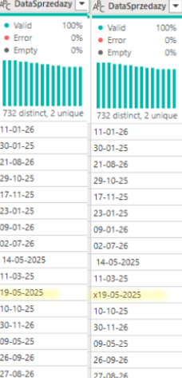
</p>

## 2. Standardize Date Format <br>
After cleaning the values, all dates were converted to a consistent date format and assigned the correct data type.

Accurate time-based analysis depends on consistent date formatting across the dataset. Inconsistent date values can lead to incorrect aggregation of sales data, impacting revenue trends, period-over-period comparisons, and seasonal performance analysis. By standardizing date formats, the dataset becomes reliable for reporting, forecasting, and strategic decision-making.

## Result
The date column was fully standardized and converted to the appropriate data type, ensuring that all transactions are assigned to the correct reporting periods. This improves the accuracy of trend analysis, supports reliable time-based reporting, and provides a solid foundation for forecasting and other analytical processes in Power BI.

<p align="center">
  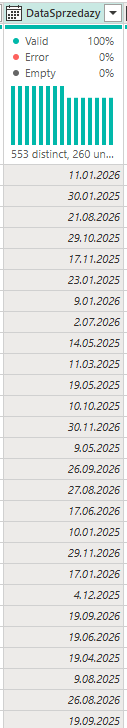
</p>

## <h1 align="center">2. Customer Data Transformation</h1>

“KlientSurowy” column contained multiple pieces of information stored in a single field and inconsistent text formatting. This structure made customer segmentation difficult.

Separating customer identifiers from customer classification is essential for effective customer analysis. When multiple attributes are stored in a single column, reporting becomes less flexible and customer segments cannot be analyzed independently. By extracting and standardizing customer information, the dataset becomes suitable for customer segmentation, behavioural analysis, campaign performance evaluation, and future customer value calculations.

After splitting the fields, customer attributes became available for direct analysis.

<p align="center">
  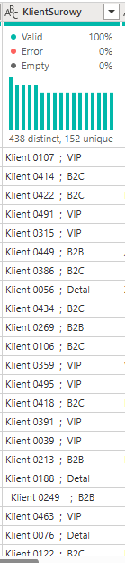
</p>

## Transformation Steps
## 1. Split Customer Information
The original "KlientSurowy" field contained multiple customer attributes stored within a single column, making the data difficult to analyze and use for reporting purposes.

To improve data usability, I applied the Split Column transformation to separate the customer identifier and customer type into two distinct fields.

<p align="center">
  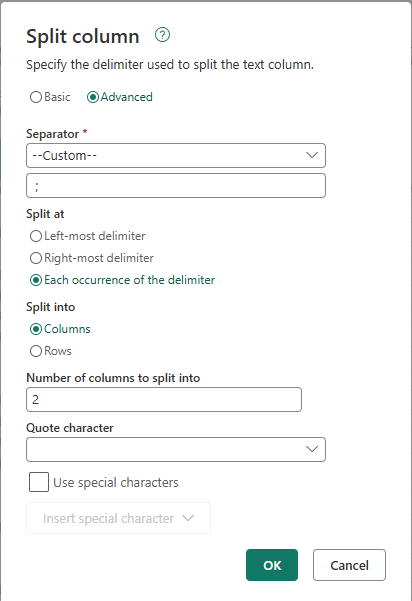
</p>

The original value: <br>

Klient 0107 ; VIP

was split into two separate columns:

ClientID     | ClientType

K0107        | VIP

<p align="center">
  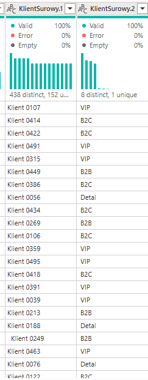
</p>

## 2. Rename Columns

Generated column names were replaced with meaningful business names:

•	ClientID

•	ClientType

<p align="center">
  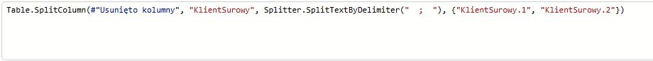
</p>

<p align="center">
  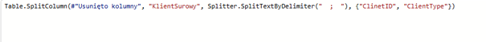
</p>

## 3. Standardize Client IDs

Client identifiers were standardized to ensure consistency across the dataset. The transformation process included converting text to a consistent format, removing unnecessary text elements, applying trimming where required, and adding the standard "K" prefix to all customer IDs. 

As a result, customer identifiers follow a uniform structure, reducing the risk of matching errors and improving the reliability of customer-related analysis.

## 4. Standardize Client Types

Customer segments contained inconsistent capitalization and formatting, resulting in multiple representations of the same customer category. To ensure consistency across the dataset, I standardized all customer type values using the UPPERCASE transformation.

<p align="center">
  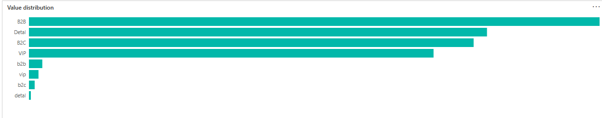
</p>

After standardization, all customer segments follow a consistent format, enabling accurate grouping and comparison of customer categories. This improves data quality and ensures that future analyses, dashboards, and business reports produce reliable results.

<p align="center">
  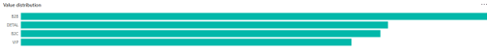
</p>

Final columns extracted from "“KlientSurowy”:

<p align="center">
  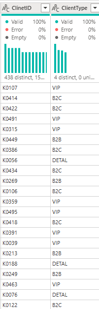
</p>

## <h1 align="center">3. Product Data Extraction</h1>
“ProduktSurowy” column contained multiple attributes combined into a single field.

<p align="center">
  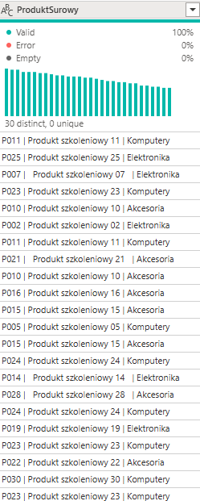
</p>

## Transformation Steps
Only ProductID was retained because detailed product attributes already exist in the Product dimension table.
This approach reduces data redundancy, improves model performance, and follows star schema design principles used in modern analytical solutions.
I used the "Extract Text Before Delimiter" transformation to isolate the ProductID from the combined text field.

The product dimension became analysis-ready and suitable for creating a star schema

<p align="center">
  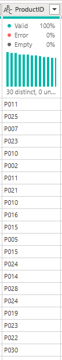
</p>

## <h1 align="center">4. Region Standardization</h1>

"Region" column contained inconsistent values caused by spelling variations and additional special characters. Examples included values such as "Polnoc" and "/Północ", both referring to the same business region.

These inconsistencies could lead to the same region being treated as multiple categories during reporting and analysis.

<p align="center">
  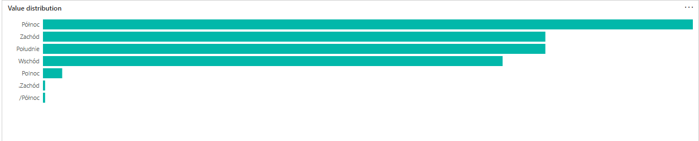
</p>

## Transformation Steps
To standardize regional data, I removed unnecessary special characters using the Replace Values transformation and corrected inconsistent spelling variations. This ensured that each business region was represented by a single, consistent value across the dataset.

Only valid region values remained:

<p align="center">
  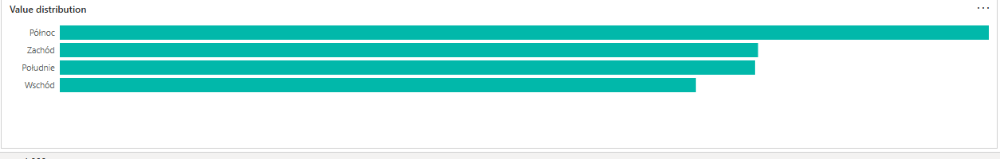
</p>

Consistent regional data is essential for accurate geographical analysis. If the same region appears under multiple names, sales and revenue may be split across separate categories, resulting in misleading reports and inaccurate performance comparisons. Standardizing region values ensures that all transactions are assigned to the correct region and enables reliable regional performance analysis.

## <h1 align="center">5. Order Status Standardization</h1>

„StatusZamowienia”  column contained inconsistent representations of the same business status due to differences in capitalization and abbreviated values.

<p align="center">
  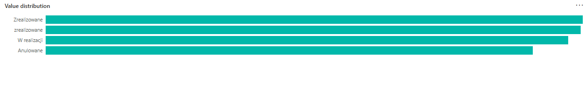
</p>

## Transformation Steps
To ensure consistency across the dataset, I applied text standardization techniques such as Replace Values.
Consistent order statuses are essential for accurate operational reporting and performance monitoring. When the same status is represented in multiple ways, transactions may be distributed across separate categories, resulting in incorrect counts and misleading metrics.

Result:

<p align="center">
  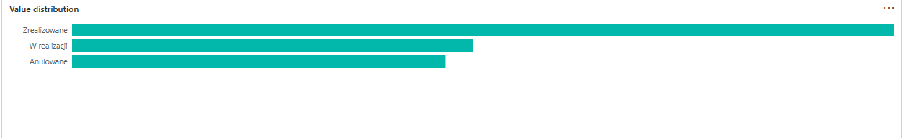
</p>

After standardization, each business status is represented by a single, consistent value. This improves data quality, enables accurate reporting of order performance, and provides a reliable foundation for further business analysis.

## <h1 align="center">6. Data Quality Validation</h1>

“IDTransakcji” validation -  a uniqueness check was performed on Transaction IDs. - 14,999 distinct, 14,988 unique

<p align="center">
  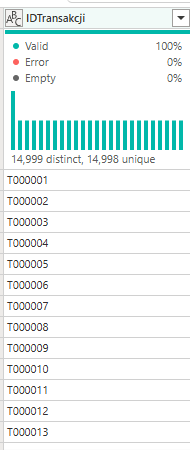
</p>

One duplicated transaction ID (T000321) was identified. Since the records contained different transaction details, they were retained as a potential business data quality issue for further investigation.

<p align="center">
  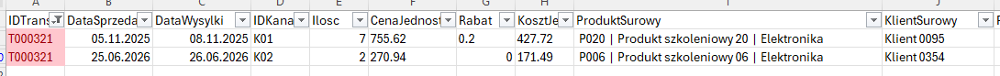
</p>

Instead of automatically removing the record, the transaction was investigated further because duplicate business keys do not always indicate duplicate transactions.

This approach reflects real-world analytical practice where data quality issues should be validated before taking corrective actions.

## <h1 align="center">7. Data Type Standardization</h1>

<p align="center">
  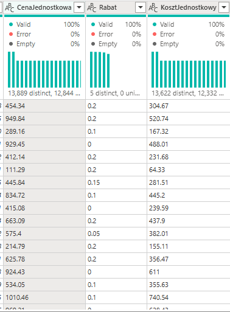
</p>

Several columns containing numerical business data were initially stored as text values such as:

- UnitPrice
  
- Discount

- UnitCost

This ensured that all numerical values could be used correctly in calculations, aggregations, and reporting processes.

<p align="center">
  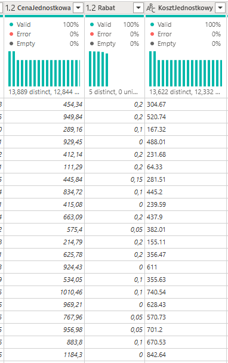
</p>

Accurate data types are fundamental for reliable business analysis. When numerical values are stored as text, calculations such as revenue, profit, average order value, or discount analysis may produce incorrect results or fail entirely. Converting these columns to numeric data types ensures that Power BI can correctly aggregate data, calculate KPIs, and support accurate business reporting.


## <h1 align="center">8. ETL Architecture</h1>

Rather than applying transformations directly to reporting tables, I created a dedicated "sprzedaz_source" query that serves as the central data preparation layer.

<p align="center">
  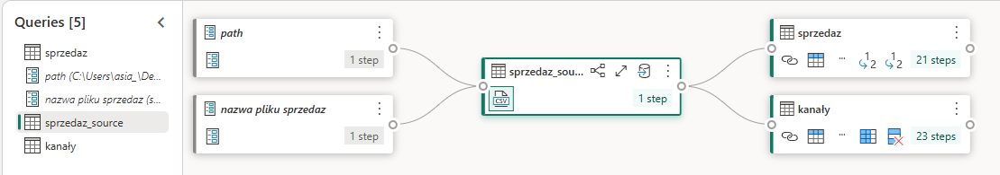
</p>

The "sprzedaz_source" table acts as a single source of truth for all subsequent analytical objects. All data quality checks, transformations, and standardization processes are performed in this layer before the data is consumed by reporting tables.

This approach follows ETL and data modeling best practices by separating data preparation from reporting and visualization layers.

Benefits

•	Single source of truth

•	Reusable transformations

•	Easier maintenance

•	Better Power BI performance

•	Scalable ETL workflow

“Sprzedaz_source” query structure:

```
let
   #"Źródło" = Csv.Document(File.Contents(#"path" & #"nazwa pliku sprzedaz"), [Delimiter = ",", Columns = 16, Encoding = 65001, QuoteStyle = QuoteStyle.None]),
   #"Nagłówki o podwyższonym poziomie 1" = Table.PromoteHeaders(Źródło, [PromoteAllScalars = true]),
  #"Zamieniono wartość" = Table.ReplaceValue(#"Nagłówki o podwyższonym poziomie 1", "x", "", Replacer.ReplaceText, {"DataSprzedazy"}),
  #"Zmieniono typ kolumny" = Table.TransformColumnTypes(#"Zamieniono wartość", {{"IDTransakcji", type text}, {"DataSprzedazy", type date}, {"DataWysylki", type date}, {"IDKanalu", type text}, {"Ilosc", Int64.Type}, {"CenaJednostkowa", type text}, {"Rabat", type text}, {"KosztJednostkowy", type text}, {"ProduktSurowy", type text}, {"KlientSurowy", type text}, {"Region", type text}, {"StatusZamowienia", type text}, {"NotatkaTechniczna", type text}, {"Kanal", type text}, {"TypKanalu", type text}, {"", type text}}, "pl"),
  #"Usunięto kolumny" = Table.RemoveColumns(#"Zmieniono typ kolumny", {"", "NotatkaTechniczna"}),
  #"Split column by delimiter" = Table.SplitColumn(#"Usunięto kolumny", "KlientSurowy", Splitter.SplitTextByDelimiter("  ;  "), {"ClinetID", "ClientType"}),
  #"Lowercased text" = Table.TransformColumns(#"Split column by delimiter", {{"ClinetID", each Text.Lower(_), type nullable text}}),
  #"Replaced value" = Table.ReplaceValue(#"Lowercased text", "klient", "", Replacer.ReplaceText, {"ClinetID"}),
  #"Trimmed text" = Table.TransformColumns(#"Replaced value", {{"ProduktSurowy", each Text.Trim(_), type nullable text}, {"ClinetID", each Text.Trim(_), type nullable text}, {"Region", each Text.Trim(_), type nullable text}}),
  #"Added prefix" = Table.TransformColumns(#"Trimmed text", {{"ClinetID", each "K" & _, type text}}),
  #"Uppercased text" = Table.TransformColumns(#"Added prefix", {{"ClientType", each Text.Upper(_), type nullable text}}),
  #"Extracted text before delimiter" = Table.TransformColumns(#"Uppercased text", {{"ProduktSurowy", each Text.BeforeDelimiter(_, "|", 0), type text}}),
  #"Renamed columns" = Table.RenameColumns(#"Extracted text before delimiter", {{"ProduktSurowy", "ProductID"}}),
  #"Replaced value 1" = Table.ReplaceValue(#"Renamed columns", ".", "", Replacer.ReplaceText, {"Region"}),
  #"Replaced value 2" = Table.ReplaceValue(#"Replaced value 1", "/", "", Replacer.ReplaceText, {"Region"}),
  #"Replaced value 3" = Table.ReplaceValue(#"Replaced value 2", "Polnoc", "Północ", Replacer.ReplaceText, {"Region"}),
  #"Replaced value 4" = Table.ReplaceValue(#"Replaced value 3", "zrealizowane", "Zrealizowane", Replacer.ReplaceText, {"StatusZamowienia"}),
  #"Trimmed text 1" = Table.TransformColumns(#"Replaced value 4", {{"Region", each Text.Trim(_), type nullable text}}),
  #"Trimmed text 2" = Table.TransformColumns(#"Trimmed text 1", {{"ClientType", each Text.Trim(_), type nullable text}}),
  #"Replaced value 5" = Table.ReplaceValue(#"Trimmed text 2", "realiz.", "Zrealizowane", Replacer.ReplaceText, {"StatusZamowienia"}),
  #"Replaced value 6" = Table.ReplaceValue(#"Replaced value 5", "", "0", Replacer.ReplaceValue, {"Rabat"}),
  #"Changed column type with locale" = Table.TransformColumnTypes(#"Replaced value 6", {{"CenaJednostkowa", type number}}, "en-US"),
  #"Changed column type with locale 1" = Table.TransformColumnTypes(#"Changed column type with locale", {{"Rabat", type number}}, "en-US")
in
  #"Changed column type with locale 1"
```

"Sprzedaz" table was created as a reference to "sprzedaz_source". This approach enables additional reporting-specific transformations and filtering without modifying the underlying source layer or affecting other dependent tables.

```
let
    #"Źródło" = sprzedaz_source

in
  #"Źródło"
```

## <h1 align="center">8. New table - "kanały"</h1>
To support efficient reporting and data modeling, I created a dedicated "Kanaly" dimension table based on the cleaned "sprzedaz_source" dataset.

Rather than storing channel information repeatedly within every transaction, a separate dimension table was created containing unique sales channels and their attributes.

Query structure:

```
let
  #"Źródło"= sprzedaz_source,
  #"Removed other columns" = Table.SelectColumns(Źródło, {"IDKanalu", "Kanal", "TypKanalu"}),
  #"Removed duplicates" = Table.Distinct(#"Removed other columns", {"TypKanalu", "Kanal", "IDKanalu"})

in
  #"Removed duplicates"
```
<p align="center">
  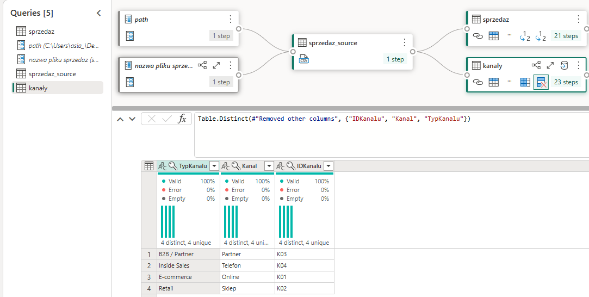
</p>

Creating a dedicated channel dimension improves both data model design and reporting performance. Instead of repeating the same channel information across thousands of sales records, channel attributes are stored once and linked to the fact table through a unique identifier.

## <h1 align="center">10. Calendar Table</h1>

I created a dedicated calendar table to support time intelligence calculations and date-based reporting.

<p align="center">
  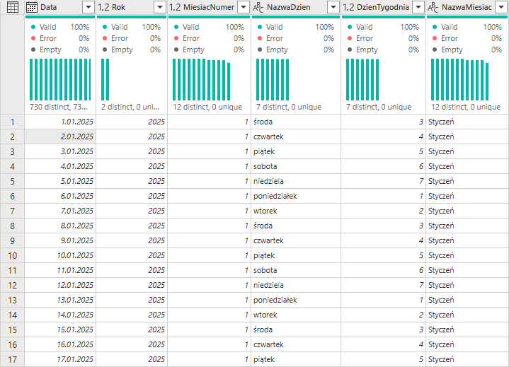
</p>

## Business Requirement

Most analytical and reporting solutions require a dedicated calendar table to perform accurate time intelligence calculations. Transaction dates alone are not sufficient for advanced analysis because they do not provide a complete date structure needed for reporting.

## Transformation Steps

The calendar table was generated dynamically based on the minimum and maximum sales dates found in the transaction dataset. Additional attributes were created to support filtering, grouping, and time-based calculations, including:

- Year
  
- Month Number
  
- Month Name
  
- Day Name
  
- Day of Week

Query structure: 

```
let
  Source = sprzedaz_source,
  #"Calculated latest" = List.Max(Source[DataSprzedazy]),
  #"Calculated earliest" = List.Min(#"Source"[DataSprzedazy]),
  LiczbaDni = Duration.Days(#"Calculated latest" - #"Calculated earliest") + 1,
  ListaDat = List.Dates(#"Calculated earliest" , LiczbaDni, #duration(1,0,0,0)),
  #"Converted to table" = Table.FromList(ListaDat, Splitter.SplitByNothing(), null, null, ExtraValues.Error),
  #"Renamed columns" = Table.RenameColumns(#"Converted to table", {{"Column1", "Data"}}),
  #"Changed column type" = Table.TransformColumnTypes(#"Renamed columns", {{"Data", type date}}),
  #"Inserted year" = Table.AddColumn(#"Changed column type", "Rok", each Date.Year([Data]), type nullable number),
  #"Inserted month" = Table.AddColumn(#"Inserted year", "MiesiacNumer", each Date.Month([Data]), type nullable number),
  #"Inserted day name" = Table.AddColumn(#"Inserted month", "NazwaDzien", each Date.DayOfWeekName([Data]), type nullable text),
  #"Added Conditional Column" = Table.AddColumn(#"Inserted day name", "DzienTygodnia", each if [NazwaDzien] = "środa" then 3 else if [NazwaDzien] = "czwartek" then 4 else if [NazwaDzien] = "piątek" then 5 else if [NazwaDzien] = "sobota" then 6 else if [NazwaDzien] = "niedziela" then 7 else if [NazwaDzien] = "poniedziałek" then 1 else if [NazwaDzien] = "wtorek" then 2 else null, type number),
  #"Inserted month name" = Table.AddColumn(#"Added Conditional Column", "NazwaMiesiac", each Date.MonthName([Data]), type nullable text),
  #"Capitalized each word" = Table.TransformColumns(#"Inserted month name", {{"NazwaMiesiac", each Text.Proper(_), type nullable text}})
in
  #"Capitalized each word"
```

The calendar table enables:
•	Year-over-Year analysis
•	Monthly trends
•	Quarterly reporting
•	Time Intelligence functions in Power BI

## <h1 align="center">10. Additional Data Sources</h1>

To support future reporting and visualization, additional datasets were imported, including "klienci", "produkty", and geografia" tables.

These datasets required only minor validation and standardization, such as checking data types, trimming spaces, and ensuring consistent text formatting before being incorporated into the data model.

## <h1 align="center">11. Query Organization</h1>

As the project grew, I organized queries into logical groups to improve maintainability and simplify navigation within Power Query.

Grouping related queries makes the ETL process easier to understand, reduces development time, and improves collaboration when working with larger data models.

Well-structured query organization improves project maintainability and scalability. As new tables, dimensions, and transformations are added, a clear folder structure helps developers and analysts quickly locate relevant queries, troubleshoot issues, and implement changes more efficiently.


Before:
<p align="center">
  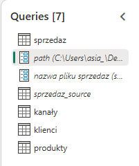
</p>

After:

<p align="center">
  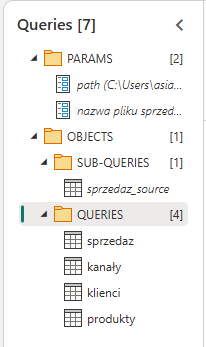
</p>

The Power Query environment became more organized, easier to navigate, and better prepared for future development. This approach follows BI development best practices and supports the creation of scalable analytical solutions.

<h1 align="center">Project Summary</h1>

The data preparation process improved the overall quality, consistency, and usability of the sales dataset.

By resolving key data quality issues and implementing a structured ETL approach, the dataset became suitable for reliable business reporting and analytical decision-making.

The resulting model supports:

- Revenue and profitability analysis
- Customer segmentation
- Sales channel performance analysis
- Regional performance analysis
- Time-based reporting
- KPI monitoring
- Future dashboard development in Power BI
  
The project demonstrates practical application of data cleaning, data quality validation, ETL design principles, and dimensional modeling techniques used in modern BI solutions.his project focused on transforming raw sales data into a reliable, analysis-ready dataset using Power Query.

During the process, multiple data quality issues were identified and resolved, including inconsistent date formats, combined customer attributes, non-standard product information, inconsistent regional values, duplicate transaction identifiers, incorrect data types, and inconsistent business status values.

The project also introduced a structured ETL architecture based on a dedicated source layer, supporting reusable transformations, improved maintainability, and scalable data modeling practices.

As a result, the dataset is now suitable for reporting, KPI calculations, customer segmentation, regional analysis, sales channel analysis, and time intelligence reporting in Power BI.

The cleaned and structured model provides a solid foundation for further business analysis and dashboard development.

<h1 align="center">Next Steps</h1>
The next phase of the project will focus on building a Power BI data model and interactive dashboards to analyze:

- Revenue trends
- Customer behaviour
- Product performance
- Regional sales performance
- Sales channel effectiveness
- Key business KPIs
